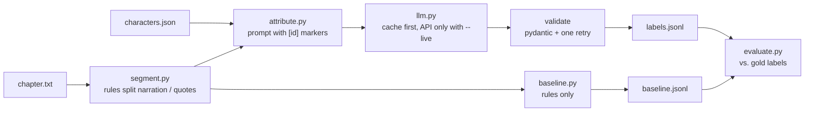

# dialogue-attribution

Who says each quote in a novel, and with which emotion? This small Python
package splits a chapter into narration and quotes, asks a language model to
label every quote with a speaker and an emotion, validates the answer, and
measures the result against hand-checked gold labels.

It is one step taken out of a larger prototype I am building: turning web
novels into full-cast audio dramas, where every character gets their own
voice. For that, the system has to know who is speaking in every line — a
wrong speaker means a wrong voice. This repository contains only that step,
kept small enough to read in one sitting.

## How it works



Design decisions:

- **Code cuts the text, the model only labels it.** Quotes are found with
  deterministic rules (nested quotes, multi-paragraph speeches). The model
  sees the passage with a marker like `[12]` in front of each quote and
  returns `{"id": 12, "speaker": "Alice", "emotion": "angry"}`. It cannot
  change, drop or invent text.
- **Closed label sets.** Speakers must come from the character list (or
  `Unknown`), emotions from a fixed set of seven. Answers are validated with
  pydantic; missing, extra or unknown labels trigger one retry with the
  reason. A second failure raises an error instead of passing a wrong label
  silently.
- **Reproducible without a key.** Every model answer is cached on disk under
  a hash of the request. The repository ships the cache of my run, so all
  results can be reproduced offline; `--live` only calls the API for requests
  not in the cache.
- **A baseline to beat.** A rule-based labeller ("…," said the Hatter) shows
  how much the model actually adds.

## Quick start

```bash
pip install -e ".[dev]"
pytest -q                               # runs offline, no key needed

# Which quotes does the segmenter find?
dialogue-attribution segments data/alice_ch07.txt

# Rule baseline and its score
dialogue-attribution baseline data/alice_ch07.txt --characters data/alice_ch07.characters.json --out results/baseline.jsonl
dialogue-attribution eval results/baseline.jsonl data/alice_ch07.gold.jsonl --name "Rule baseline"

# LLM labels, read from the shipped cache (offline)
dialogue-attribution run data/alice_ch07.txt --characters data/alice_ch07.characters.json --out results/llm.jsonl
dialogue-attribution eval results/llm.jsonl data/alice_ch07.gold.jsonl --name "LLM"
```

### Live run

Any OpenAI-compatible endpoint works. Keys are read from environment
variables only and are never written to the cache.

```bash
export LLM_API_KEY=...        # PowerShell: $env:LLM_API_KEY="..."
export LLM_BASE_URL=https://openrouter.ai/api/v1   # or any OpenAI-compatible server
export LLM_MODEL=<model name>
dialogue-attribution run data/alice_ch07.txt --characters data/alice_ch07.characters.json --out results/llm.jsonl --live
```

A live run also writes `results/llm.meta.json` with the model, date,
commit, number of requests, tokens and seconds.

## Results

Alice's Adventures in Wonderland, chapter 7 ("A Mad Tea-Party"): 147 quotes,
four speakers (Alice, Hatter, March Hare, Dormouse).

| Method | Speaker accuracy | Emotion agreement | Source |
|---|---:|---:|---|
| Rule baseline | 89.8 % (132/147) | 60.5 % (89/147) | measured 2026-11-01, `results/baseline.jsonl` |
| LLM (`openrouter/google/gemini-3.7-flash`) | 97.3 % (143/147) | 89.8 % (132/147) | measured 2026-11-01, commit `ddfa673`, 1 request, 38.1 s, 4,149 prompt + 8,357 completion tokens (`results/llm.meta.json`) |

- **Speaker accuracy**: share of quotes whose predicted speaker matches the
  gold label. When several characters speak at once ("they cried"), any of
  them counts as correct.
- **Emotion agreement**: share of quotes where the predicted emotion is one
  of the accepted gold emotions. Emotion is subjective, so read this as
  agreement with my labels, not as accuracy. Where careful readers split
  evenly (3 of 147 quotes), the gold label accepts several emotions. The
  baseline always answers "neutral"; its score equals the share of quotes
  whose gold label accepts neutral.
- **Where the LLM fails**: all four of its speaker errors are group speech
  ("they cried", "they both cried", "Sh! sh!"). The model answered
  `Unknown` instead of picking one speaker, because the label format allows
  only one. Every quote with a single speaker (143 of 147) was attributed
  correctly. Allowing several speakers per quote is the obvious next step.
- All numbers above are measured on this one chapter; nothing is estimated
  or extrapolated.

  
## Data

- `data/alice_ch07.txt` — chapter 7 of *Alice's Adventures in Wonderland*
  by Lewis Carroll (public domain), from Project Gutenberg eBook #11; the
  Gutenberg header and footer are removed.
- `data/alice_ch07.characters.json` — the characters who speak in this
  chapter, written by hand. Recognising characters and their aliases
  automatically is out of scope here.
- `data/alice_ch07.gold.jsonl` — one reference label per quote. The labels
  were drafted with the help of an AI assistant and then checked line by
  line by me. Emotions I questioned were re-checked in two further
  independent AI-assisted passes and decided by majority; ties accept
  several emotions. `text_start` makes the tests fail if the gold file and the
  segmenter ever drift apart.

## Limitations

- English double quotes (curly or straight) only; single quotes are treated
  as apostrophes or nested quotes. A single unclosed quote mark turns the
  text after it into one quote, up to the next paragraph that opens with a
  quote mark.
- One speaker per quote; group speech is scored leniently.
- Thoughts are attributed to the thinking character like speech.
- Long texts are sent in chunks of whole paragraphs (`--max-chars`, default
  20,000); chunks do not see each other. Chapter 7 fits into one request.
- One chapter, one annotator: enough to compare methods on this text, not a
  general benchmark.

## Project layout

```
src/dialogue_attribution/
  segment.py    narration / quote segments with character offsets
  schema.py     pydantic models and the closed label sets
  llm.py        OpenAI-compatible client (stdlib only) and file cache
  attribute.py  prompt, chunking by paragraph, validation, retry
  baseline.py   rule-based comparison
  evaluate.py   accuracy against gold labels, Markdown report
  cli.py        segments | baseline | run | eval
tests/          pytest, fully offline (fake client, local test server)
data/           chapter text, character list, gold labels
cache/          cached model answers, one folder per model
results/        outputs and run metadata
```

Developed with the help of an AI coding assistant; I reviewed every line and
can explain each design decision.

## License

Code: MIT (see `LICENSE`). The chapter text is in the public domain.
